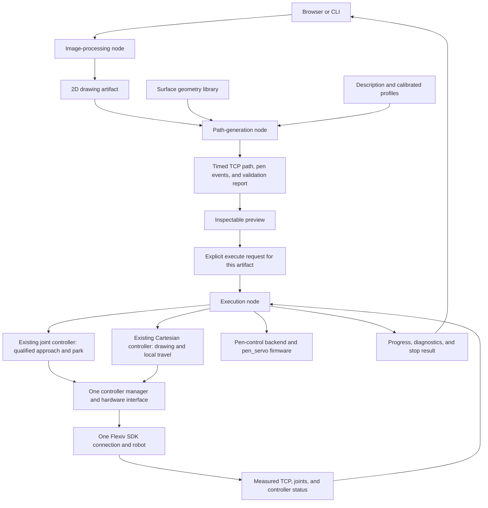

# 3D pen architecture and implementation plan

Agreed: 2026-10-24, after Eddie and Sam's sync.
Status: modular software installed; package, firmware-build, and complete browser-to-ROS fake-hardware checks passed. Physical measurements and live qualification remain pending.

This is the single combined architecture. It keeps Eddie's package separation and incorporates Sam's surface, calibration, execution, ESP32, and validation requirements. It supersedes `eddie_proposal.md` and `sam_proposal.md`.

## Product workflow

Input image + selected flat or spherical surface → inspectable 2D drawing → timed surface-following TCP path and extrusion schedule → Preview → explicit Execute → result and measured feedback.

Preserve the existing four-panel browser appearance, camera/orbit viewpoint, and progressive drawing visualization. Preview compiles and displays the exact job. Execute remains disabled until Preview succeeds for the current image, surface, size, settings, and calibration. Any relevant edit invalidates that permission. Enforce the same rule on the server; clicking a disabled button is not the only protection. Preview success permits fake execution; real execution additionally requires complete measured calibration and qualified hardware. Playback speed never changes robot execution speed.

No MoveIt is used. Reuse the existing single Flexiv hardware connection and 1000 Hz controller-manager loop. The robot's solver determines joint motion from TCP targets; our application computes surface-following poses, timing, clearances, and pen events.

The browser additionally computes an offline joint preview using the current
URDF and CAD pen tip. `robot_preview.json` starts at the saved joint snapshot,
approaches the workpiece, follows the timed drawing/lift phases, retracts and
returns. Play consumes those frames instead of leaving the arm frozen while
animating a marker. This bounded IK is visualization-only; it does not replace
the robot's solver or establish collision-free physical motion.

Eddie owns software organization and end-to-end integration. Sam supplies holder, pen, camera, fixture and TCP measurements. All missing measurements remain explicit `TBD`/null values. The known sphere diameter is 80 mm (radius 0.040 m). User input images such as the planned Tylenol and mackerel scans belong in `assets/inputs`; supplied scans are not assumed to exist yet.

## Package boundaries

A package organizes source code, dependencies, interfaces, and tests. A node is a running participant in the ROS graph. A library provides reusable functions. These are different boundaries: a separate package does not require a separate process or a ROS request for every calculation.

| Package | Responsibility | Output / boundary |
| --- | --- | --- |
| `pen_image_processing` | Image cleanup, scaling, outlines, useful internal details, and optional fill/relief extraction. No robot poses or controller commands. | Inspectable 2D drawing geometry with explicit units and scale. |
| `pen_surface_geometry` | Analytical plane/sphere models, coordinate mapping, normals, and surface-distance/clearance calculations. No controller or job state. | Pure geometry functions returning surface points and directions. |
| `pen_toolpath` | Stroke ordering, draw/lift/travel paths, tool orientation, calibrated frame conversion, speed/acceleration timing, and scheduled pen events. | Versioned timed TCP path and geometric validation report. |
| `pen_execution` | One job owner: readiness checks, qualified joint routes, controller switching, timed target publication, pen-control coordination, progress, cancellation, and stop handling. | Robot commands and measured execution status. |
| `pen_description` | Pen/holder/jig/workpiece meshes, assembly xacros, frame definitions, and calibration profile schema. | A consistent model and measured transforms for planning and display. |
| `pen_interfaces` | Shared ROS messages/actions and documented data semantics. | Stable contracts without image-processing or execution logic. |
| `pen_bringup` | Launch files, deployment configuration, and the thin browser/ROS bridge. | Repeatable preview, fake-hardware, and real-hardware configurations. |
| `pen_servo` | C++ servo behavior/state machine, host-testable logic, and standalone ESP-IDF firmware. | Logical extrusion requests become bounded, debounced servo press/release on the ESP32. |

The existing `flexiv_cartesian_controller`, Flexiv hardware interface, vendor description, and joint controller remain underneath these packages. They are not duplicated or replaced.

Keep the browser adapter thin: upload/select, submit preparation or execution requests, display results, and request Stop. Image algorithms and controller ownership stay in their packages. A dedicated UI package is optional if the browser code grows; it is not required to establish these core boundaries.

## Workspace and assets

```text
robotics_ws/
  assets/
    meshes/           # canonical STL files and provenance manifest
    inputs/           # JPG/PNG inputs, including user scans when available
    outputs/<job>/    # drawing, relief, toolpath, timed job, report, execution result
  src/
    pen_interfaces/
    pen_image_processing/
    pen_surface_geometry/
    pen_toolpath/
    pen_execution/
    pen_description/
    pen_servo/
      firmware/       # independent ESP-IDF target; excluded from colcon crawling
    pen_bringup/
      web/            # recovered browser style/viewer plus Preview/Execute wiring
    flexiv_cartesian_controller/  # existing
    flexiv_description/           # existing vendor model
    flexiv_ros2/                  # existing driver/controllers
    3d-pen/                      # history/compatibility during migration; COLCON_IGNORE
  .venv-pen/          # isolated scientific Python dependencies
  docs/architecture.md
```

Original Git histories and existing Flexiv modifications are preserved. Extracted packages are independently discoverable by colcon. The old project becomes a compatibility/reference checkout instead of another independent implementation. Keep canonical meshes in assets/meshes; package installation may copy them for package:// URIs. Never maintain two independently edited CAD sets. Inputs and generated outputs are data, not ROS packages. Generated outputs are excluded from package discovery and version control.

Scientific image/geometry code runs in the isolated Python 3.10 environment. ROS wrappers use ROS system Python and invoke bounded worker processes using versioned JSON. Do not install NumPy 2 into ROS system Python. Package setup and worker installation are explicit parts of installation.

## Data and execution flow



The arrows describe data and ownership, not an automatic chain that begins motion when a new image arrives. Preparing and previewing never start execution. The execute request identifies the exact reviewed artifact.

Start with three application nodes:

1. **Image-processing node:** wraps the image library and returns the drawing artifact.
2. **Path-generation node:** uses the surface and toolpath libraries to produce the timed job and previews.
3. **Execution node:** owns physical execution and all associated state transitions.

`pen_surface_geometry` starts as a library, not a server. There is no need to send thousands of ROS requests to evaluate points on a sphere. The browser bridge and existing robot-state/driver nodes are additional infrastructure, not new owners of motion.

## Contracts between stages

| Boundary | Required meaning |
| --- | --- |
| Image → drawing | Ordered or identifiable 2D curves/regions, coordinate convention, physical scale/units, extraction settings, and input identity. Independent of the jig's world placement. |
| Drawing + surface → path | Selected surface and drawing placement, calibrated transforms, tool identity, permitted working patch, and process limits. |
| Path → execution | TCP poses in the declared robot-world frame, relative execution times, explicit DRAW/LIFT/TRAVEL phases, pen events, qualified approach/park references, and validation evidence. |
| Execution → UI/logs | Job and stage identity, current phase/stroke, progress, measured tracking, controller states, pen-request/available feedback state, and concrete failure reason. |

Use metres for spatial execution data and seconds for relative timing. Document orientation order as ROS `x, y, z, w`. Distinguish relative trajectory times from the fresh timestamps attached to commands when they are sent.

Attach schema version, input/settings identity, and tool/calibration/geometry versions or hashes to each artifact. Changing the image invalidates downstream results. Changing calibration invalidates world-frame paths without requiring the same image to be extracted again. Preview and execution consume the same compiled job, not independently generated paths.

Use actions for preparation/generation and execution when they need progress and cancellation. Use topics for continuous measured state, diagnostic status, preview markers, and the existing Cartesian target stream. Use short services only for bounded queries or configuration operations. Keep interface definitions in `pen_interfaces`; avoid a dependency cycle between processing and execution packages.

## Surface-following geometry and clearance

For sphere center c, R = 0.040 m, outward unit normal n(s,t), and stand-off/layer height h:

~~~text
p_tip(s,t) = c + (R + h) * n(s,t)
~~~

Compute this in the calibrated surface frame and transform to robot world. Existing sphere projection supplies n(s,t). Point the pen inward along the normal, preserve quaternion sign and transport roll continuously. Restrict initial jobs to a small upper angular patch.

For an axis-aligned upper hemisphere, surface height is cz + sqrt(R² - (x-cx)² - (y-cy)²). This explains why Z must change with X/Y. Implement the parametric form so fixture rotation and radial offsets work correctly.

Between strokes, use **lift → follow an offset surface → lower**, with extrusion off. On the sphere, lift radially, travel on a larger-radius shell, then lower radially. The compiler evaluates the analytical surface throughout travel, preserving the original slicer's curved-route behavior instead of connecting XYZ endpoints directly. On a plane, lift along the calibrated plane normal, which need not be world Z.

### Sampling must not cut through the sphere

Two valid endpoints do not make a valid connecting segment. For adjacent shell points at radius rho = R + h separated by angle theta, their straight chord reaches radius rho*cos(theta/2). Its inward error is rho*(1-cos(theta/2)). For example, a 5 mm chord on a 40 mm sphere cuts inward by about 0.078 mm.

Evaluate the analytical surface along the timed trajectory and choose dense samples from an explicit clearance budget. Include chord/sampling error, calibration error, tracking error and numerical rounding. Require the intervening motion to stay outside the surface plus the budgeted margin; shrink spacing or increase stand-off otherwise. Exact zero-gap contact is not guaranteed by finite samples and unknown tracking.

The implemented compiler checks the sampled drawing/lift/travel/air-offset path's tip chords and a conservative pen/holder capsule against the selected analytical surface. Preserve the report with the exact path/profile hashes. The capsule dimensions must enclose the real tool assembly. Fixture, tabs, table and full-arm collision checks are not automated: reports explicitly set `fixture_collision_checked=false` and `full_arm_collision_checked=false`. Their clearance and the approach/park routes require physical qualification before real execution. These flags must not be interpreted as a collision-free robot plan.

### Timing and the full-arm limitation

Generate bounded linear/angular velocity and acceleration outside the RT controller. A conservative starting implementation uses a smooth rest-to-rest time law per short surface-coordinate segment, evaluating XYZ from the surface mapping; stop at sharp corners. Qualify deposition through repeated stops before adding blends. Sending sparse endpoints does not create a smooth curved trajectory automatically.

This is **not a general full-arm collision planner**. Without MoveIt or another robot planner, we do not prove future elbow/link clearance or compute arbitrary joint routes. Restrict execution to physically qualified joint routes and a small clear Cartesian patch. Monitor actual joints, TCP tracking and readiness; stop on unexpected posture, limit proximity or errors. Test the complete arm path in air before contact. URDF collision tags and delayed monitoring do not guarantee future avoidance.

Flexiv receives TCP targets, not the sphere/jig STL as an obstacle. Its streaming API and the local controller do not implement this project's surface routing. Use the existing controller [API contract](flexiv_cartesian_controller_api.md) and installed RDK headers.

## Calibration and description integration

Define T_A_B as the pose of B expressed in A.

~~~text
T_world_tip    = T_world_surface * T_surface_tip
T_world_flange = T_world_tip * inverse(T_flange_pen_tip)
T_world_tcp    = T_world_flange * T_flange_rdk_tcp
~~~

`T_world_surface` locates the sphere center or plane drawing face. The renderer derives `T_jig_surface = inverse(T_world_base * T_base_jig) * T_world_surface`; it is not a second independent world-placement input. Real profiles currently require `T_world_base` to be identity because the controller passes `world` targets directly to the RDK's robot-base coordinates. Preview and fake rendering can use a translated or rotated base, but no runtime world-to-base conversion is implemented for physical commands.

Prefer an active RDK TCP at the physical pen tip. The legacy job exported flange poses using only pen length; never send them unchanged as tip targets. Record full orientation/translation, not just length. ROS quaternion order is qx,qy,qz,qw; existing controller/hardware code converts to RDK order.

Measure tip calibration using multiple orientations about a fixed reference and independent check points. Register a plane from three non-collinear points plus check points. Register sphere center and fixture orientation; use a fixture marker to resolve image yaw. Confirm the supplied 80 mm diameter and update old radius/raise_m consistently.

Profiles include serial, tool name/TCP, payload/CoM/inertia, assembly transforms, fixture registration, tool envelope, pen timing and qualified routes. CAD units and hashes live in the canonical mesh manifest; jobs retain their profile identity and validation limits. Configure/select the tool while idle before driver startup.

**Implemented gate:** real execution checks the loaded hardware identity, `commissioning_verified`, measured/non-synthetic profile flags, qualification flags for RT/clearance/pen/tool, and the profile source hash. These are manual commissioning declarations plus software consistency checks. They do not read or verify the robot's active tool, TCP or payload, and they do not prove the driver loaded the same description/profile.

**Pending automatic verification:** read `Tool::name()` and `Tool::params()` through the existing hardware owner, compare active TCP/mass/CoM/inertia with the profile, and reject mismatches. Those SDK methods block, so this belongs outside the control update loop. Never open another SDK connection. Until that check exists, tool/description matching is a manual commissioning responsibility; changing either invalidates that commissioning evidence and session.

### Description components and frames

The project xacro fragments in `src/pen_description/urdf` have these attachment responsibilities:

- pen_cell.urdf.xacro composes the existing vendor robot and the two project fragments, retaining its hardware interfaces and serial-prefixed arm frames.
- pen_tool.xacro attaches the actual holder and pen rigidly to the serial-prefixed flange and defines separate `pen_tip` and `pen_rdk_tcp` frames. Keep the holder's CAD-origin correction separate from the flange-to-tip calibration; loading the holder STL does not determine the TCP.
- pen_fixture.xacro places the jig with `T_base_jig` and attaches the selected sphere/flat piece using the derived `T_jig_surface`. The intended physical placement is in front of the base along base +X; its exact measured pose remains unset. The renderer accounts for the world-to-base relationship, subject to the current real-control identity constraint above.
- Fixed joints, separate component frames and visual/collision elements retain the assembly geometry. The sphere radius is 0.040 m. The flat mesh is 0.08 × 0.10 × 0.0025 m; its mesh origin is offset below the plane's drawing-face frame. Real plane profiles must explicitly supply those dimensions.
- An optional vendor D405 model attaches through `camera.T_flange_camera`, the pose of its bottom screw mount relative to the flange. It stays disabled until that transform is provided. Loading the model does not start the camera driver.

Canonical assets are verified against `assets/meshes/manifest.json` and copied at package installation to `share/pen_description/meshes`. URDF mesh URLs use that installed package path. Rebuild after a canonical mesh change; do not edit installed copies independently.

### Calibration placeholders

The implemented template is `src/pen_description/config/calibration.template.yaml`. The following is its configuration shape; all transforms use ROS quaternion order. Assembly transforms are top-level fields, with the optional camera transform under `camera`. It is not a usable calibrated configuration:

~~~yaml
schema_version: 1
profile_id: mocha-measured-TBD
calibrated: false
fake_only: false
synthetic: false
robot_sn: Rizon4s-063112
world_frame: world
surface:
  type: sphere
  radius_m: 0.040
T_world_surface: {xyz_m: null, quaternion_xyzw: null}
T_world_base: {xyz_m: null, quaternion_xyzw: null}
T_base_jig: {xyz_m: null, quaternion_xyzw: null}
T_flange_holder: {xyz_m: null, quaternion_xyzw: null}
T_holder_pen: {xyz_m: null, quaternion_xyzw: null}
T_flange_pen_tip: {xyz_m: null, quaternion_xyzw: null}
T_flange_rdk_tcp: {xyz_m: null, quaternion_xyzw: null}
rdk_tool_name: null
payload: {mass_kg: null, com_m: null, inertia_kg_m2: null}
pen: {release_delay_s: null, press_delay_s: null, max_press_s: null}
tool_envelope: {radius_m: null, length_m: null}
qualified: {cartesian: false, rt: false}
qualification: {rt: false, clearance: false, pen: false, tool: false}
routes: {approach: null, park: null}
camera:
  enabled: false
  model: D405
  T_flange_camera:
    xyz_m: null
    quaternion_xyzw: null
~~~

The loader rejects missing/non-finite transforms and non-unit quaternions; null never means identity or zeros. Portable image processing and unplaced asset inspection can work without these fields. `src/pen_description/config/fake.yaml` supplies an explicit synthetic, fake-only assembled profile for preview and fake execution. It cannot pass the real-mode gate. Do not persist its placements as measurements. A physical profile's identity `T_world_base` must be stated explicitly after establishing the required coordinate convention.

Later calibration fills these transforms and records its residual/tolerance evidence in the local measured profile and commissioning record. No measured jig position, holder mounting transform or TCP offset is selected by this plan.

The existing `rizon.launch.py` and combined Cartesian bringup now accept `description_file`, defaulting to the vendor xacro. `pen_description` renders and validates the composed URDF first; fake bringup passes that file through the existing driver chain, feeding one controller manager and robot-state publisher. Hardware interfaces and existing local source changes are preserved. Real deployment must likewise pass the validated composed description; the application does not automatically replace an already running driver's model. Check expanded URDF and TF before live use.

URDF geometry, RDK TCP/payload configuration, and application clearance checks are three separate responsibilities.

## Execution and switching

One executor owns job state, joint goals, switches, pen commands and TCP publication. The implemented browser exposes **Preview**, **Execute**, and **Stop**; its separate **Play** button controls visualization only. Preview performs extraction, compilation and validation. Execute owns approach, drawing and park as one job. The worker also supports separately compiled air-offset jobs through its request API; there is no additional browser air-run button. There is no browser controller selector. Active Cartesian mode requires fresh hold targets.

~~~text
IDLE → EXTRACTING → TARGET_READY → COMPILING → VALIDATING → READY
READY + Run → PREFLIGHT → QUALIFIED_JOINT_APPROACH → CARTESIAN_HOLD
            → AIR_RUN or DRAW → RETRACT → QUALIFIED_JOINT_PARK → COMPLETE
Failure/cancel → STOPPING → STOPPED or FAULT
~~~

1. Accept one task across all clients, identified by a server-owned artifact and exact digest. Reject stale profile/CAD/settings, old preview-only jobs and unqualified starts. Verify current readiness and fresh feedback; check for competing Cartesian publishers.
2. Send a taught joint route through /rizon_arm_controller/follow_joint_trajectory only from its qualified start tolerance. If elsewhere, require supervised repositioning or another qualified connecting route. Do not assume a direct interpolation to home is clear. Home means park, not encoder zeroing.
3. At a clear standoff, issue one STRICT switch deactivating rizon_arm_controller and activating flexiv_cartesian_controller. Check response and actual states. Failure does not imply rollback.
4. Be ready to publish post-activation targets immediately. Inactive/old messages are ignored and activation seeds measured pose. Start fresh holds inside the 0.1 s grace; verify actual entry pose before advancing.
5. Send current-stamped PoseStamped targets in world with best-effort, volatile, depth-one QoS. Start with the offset helper's 100 Hz as a candidate; choose final rate from curvature spacing and tracking tests. The controller streams latest targets at 1000 Hz and does not interpolate paths.
6. Schedule with monotonic elapsed time and stamp with synchronized ROS system time. Stop on missed budget, stale feedback/status, target rejections, tracking/posture errors or unexpected controller state. Do not catch up by jumping ahead or conceal a stalled worker by freshly stamping its last target.
7. On success, pen off, validated retract, zero-speed hold, strict switch to joint control and qualified park route. Verify stopped feedback and pen off before completion.

Measure direct /flexiv_rizon_arm/joint_states rate for monitoring; aggregated /joint_states is configured at 30 Hz. The executor uses vendor TCP before switching, then the active plugin TCP. It validates frame, finite values, quaternion, timestamp and receipt age. Explicit fake mode initializes and prepositions only mock hardware. Initial execution waits a bounded interval for the first client heartbeat before any hardware commands; ongoing heartbeat expiry has no repeated grace period.

Stop requests pen off, cancels joint goals, stops targets and requests Cartesian deactivation without indefinitely waiting on one subsystem. The controller watchdog is a fallback, not an instant emergency stop. Never automatically retract, restore motion, clear faults or resume after failure. Heartbeat loss stops execution; process restart does not resume it. Show unconfirmed stop state clearly.

## Pen actuation

### Selected hardware and software boundary

The user has selected this chain: **Flexiv control-box digital output 0 → existing voltage/logic interface → ESP32 digital input → servo → physical extrusion button**. Retain it. The ROS application controls the extrusion request; the ESP32 generates servo pulses locally. Do not send servo PWM from ROS or repeatedly toggle DO0 at the servo pulse frequency.

The following hardware details are now user-supplied, rather than unknown defaults:

| Item | Value / evidence |
| --- | --- |
| Board | ESP32 DevKit V1; confirm its module marking/flash configuration when setting up the toolchain |
| Servo signal | Board pin D18, GPIO18 |
| Tested release position | Arduino sketch command value 110 |
| Tested press position | Arduino sketch command value 130 |
| Extrusion-request input | D35, GPIO35; confirmed inverted DO0 signal, active LOW |

The user measured the existing interface as follows. Treat this polarity as specified; keep the logical PRESS/RELEASE requests independent of the electrical inversion.

| Logical request | Flexiv DO0 | ESP32 D35 | Servo command on D18 |
| --- | --- | --- | --- |
| PRESS / extrusion requested | ON, approximately 24 V | Approximately 0.2 V, LOW | 130 |
| RELEASE / extrusion off | OFF, approximately 0 V | Approximately 3.3 V, HIGH | 110 |

Configure GPIO35 as a digital input. In Arduino this is pinMode(35, INPUT) followed by digitalRead(35); in ESP-IDF use gpio_set_direction(GPIO_NUM_35, GPIO_MODE_INPUT) and gpio_get_level(GPIO_NUM_35). The input decoding is active-low:

~~~cpp
const bool press_requested = (gpio_get_level(GPIO_NUM_35) == 0);
~~~

This expression decodes the request only: the boot/rearm, debounce and timeout state machine must still decide whether pressing is allowed. Use the numeric GPIO identifiers rather than assuming an Arduino board definition provides D35/D18 aliases. See Espressif's [ESP-IDF GPIO API](https://docs.espressif.com/projects/esp-idf/en/stable/esp32/api-reference/peripherals/gpio.html) and [Arduino digitalRead API](https://docs.espressif.com/projects/arduino-esp32/en/latest/api/gpio.html).

The standalone **ESP-IDF v5.4.2** project is `src/pen_servo/firmware/pen_servo_esp32`, targeting classic `esp32` for the DevKit V1. It uses C++ with an `app_main` entry point. Its build is independent of colcon and the image Python venv; `src/pen_servo/firmware/COLCON_IGNORE` excludes the nested project from package discovery. No ROS or micro-ROS is needed on the ESP32 for this digital-input interface. The existing Arduino sketch is useful calibration evidence; preserve its source/library configuration when available rather than maintaining two production firmware implementations.

The implemented adapter uses ESP-IDF [LEDC hardware PWM](https://docs.espressif.com/projects/esp-idf/en/v5.4.2/esp32/api-reference/peripherals/ledc.html) on GPIO18. Arduino-ESP32 and Espressif's MCPWM servo example are alternatives from the original proposal; neither is a second maintained firmware path here.

Set servo output to GPIO18, release to **110°**, and press to **130°**. ESP-IDF converts these angles using calibrated pulse widths at 0° and 180°; never use 110 or 130 directly as microseconds or duty counts. PWM endpoints, frequency, debounce and maximum press duration remain TBD. GPIO35 is active-low. Keep servo configuration separate from robot TCP calibration.

GPIO35 on the ESP32 is input-only and has no internal pull-up or pull-down. The external interface must provide a defined HIGH/released level when the command connection is absent; firmware cannot obtain it by enabling an internal pull resistor. The measured 3.3 V when DO0 is off does not by itself prove behavior when wiring is disconnected or the interface loses power, so test those cases separately. See Espressif's [GPIO restrictions](https://docs.espressif.com/projects/esp-idf/en/stable/esp32/api-reference/peripherals/gpio.html).

Verify the existing “step-down” circuit translates the DO0 signal into a valid ESP32 logic input; a power-supply buck converter alone is not necessarily a logic interface. Document input voltage/polarity, a defined inactive level on disconnect, and the ground reference or isolation. Power the servo from an appropriate supply rather than an ESP32 GPIO. Test boot/reset/brownout and mechanical button release on the actual circuit.

### How the ESP32 firmware is installed and runs

The project firmware must be **flashed onto the board**, rather than running as a process on Mocha. Build it with ESP-IDF, connect the board over USB, explicitly identify its serial port, and upload it with idf.py -p <confirmed-port> flash. This replaces the application currently stored on the board, such as the user's test Arduino sketch. Do not flash it as part of ordinary robot startup or as an automatic side effect of launching the browser application. See Espressif's [build/flash instructions](https://docs.espressif.com/projects/esp-idf/en/stable/esp32/get-started/start-project.html).

After flashing, the program remains in nonvolatile flash. On normal power-up/reset, the bootloader loads it and starts the application automatically, entering app_main for ESP-IDF. No Arduino IDE, ROS process or repeated upload is needed to keep it running; the board and servo still need their appropriate power supplies. USB can be disconnected if it is not needed for power or the optional heartbeat/status link. See the [ESP32 startup flow](https://docs.espressif.com/projects/esp-idf/en/stable/esp32/api-guides/startup.html).

The test sketch may already be stored from the previous upload; its current presence has not been inspected in this task. Installing the final firmware requires one deliberate flash operation, repeated only for firmware/configuration updates. Confirm release behavior on power-up before connecting motion and extrusion. The released-on-boot and inactive-before-arm requirements apply every time calibrated firmware starts. The default unconfigured build instead disables PWM and leaves GPIO18 as an input; without a measured release pulse it cannot establish mechanical button release.

### ESP32 input-to-servo behavior

The portable C++ state machine and ESP-IDF adapter implement:

1. With valid measured configuration, boot/reset commands the calibrated released position and remains disarmed. An already-active DO0 cannot press during startup. Missing configuration leaves PWM disabled and the machine unconfigured.
2. Observe stable HIGH on GPIO35 (inactive/release request) before accepting a subsequent HIGH-to-LOW active transition. Debounce the conditioned input.
3. While armed and GPIO35 is LOW, command the calibrated pressed position (130°). On HIGH, command release promptly (110°); do not wait for a blocking delay or a full press cycle.
4. Impose a maximum continuous press duration. On expiry, release and latch a fault; never reset that timer simply because DO0 remains HIGH/GPIO35 remains LOW. Rearm by sending uppercase `R` over the serial console while the input is stably inactive, or reset and repeat the inactive-before-arm sequence.
5. Record firmware reset cause, input state, commanded servo state and fault information for bench debugging. A commanded servo position is not measured button position or confirmed plastic flow.

A static DO0 level cannot distinguish a valid long stroke from a frozen host that left DO0 high. The maximum press duration bounds this condition but is not immediate host-loss detection. Compile the maximum permitted continuous extrusion duration into each job's checks; split strokes or reject jobs exceeding the calibrated cap rather than silently extending it.

For quicker host-failure detection and observable status, optionally add USB serial between Mocha and the ESP32 for a session/arm command, heartbeat and status. Keep DO0 as the extrusion request, but permit pressing only while that session heartbeat is fresh; a missed heartbeat releases and latches the fault even if DO0 stays high. Generate heartbeat from executor liveness, not from an independent process that can keep approving a stalled job. The reusable C++ state machine has a host-tested optional heartbeat gate, but the current ESP-IDF adapter disables it and has no host heartbeat protocol. This extra connection remains a proposed enhancement. Serial bench logs are not an integrated ROS acknowledgement channel. Without such a channel, the host cannot claim the ESP32 received DO0 or physically released the button.

### ROS integration and synchronization

Add a DO0 backend to the existing executor's pen-control interface, alongside the mock backend. Publish flexiv_msgs/msg/GPIOStates to /Rizon4s_063112/gpio_outputs, setting only pin 0. Make topic/serial configurable. Map logical extrude=true to DO0 high (approximately 24 V, GPIO35 LOW) and extrude=false to DO0 low (approximately 0 V, GPIO35 HIGH). The ESP32 handles the active-low input; do not invert the ROS command a second time. Keep other digital outputs unchanged.

Use the existing gpio_controller and single hardware owner throughout joint/Cartesian switching. At explicit job initialization, command inactive DO0 and establish the firmware's released/ready state before the first extrusion request. Set active only for DRAW; set inactive before lifting, travel, controller switches, completion and cancellation. No connection or output command occurs merely by uploading or preparing an image.

Every pen-raise transition must include an explicit extrusion-release event in the compiled motion schedule, even if extrusion is already believed to be off. The planner records this event; the executor sends the DO0 command when executing the job. The sequence is: finish the stroke → set DO0 LOW/off → GPIO35 becomes HIGH → ESP32 commands servo release (110°) → allow the calibrated release/flow-stop delay → lift → travel with extrusion off → lower at the next stroke → resume with calibrated extrusion-start timing. A release command is not a measured release acknowledgement; use available feedback or the qualified delay, and abort if required feedback fails.

Do not infer release merely from positive world-Z motion. A pen raise is the explicit LIFT/TRAVEL phase moving away from the surface along its local normal; world Z also changes during valid drawing on the sphere. GPIO event generation follows stroke/phase boundaries, not the sign of a coordinate change.

The current GPIO topic provides a request, not physical output/servo feedback. Distinguish request submitted, optional ESP32-reported input/command state, and actual extrusion; only report acknowledgements available from a real feedback path. Bench calibration/observation or an added sensor is needed to verify the button and flow.

Existing GPIO preserves unspecified outputs and does not reset DO0 when a controller is deactivated. On cancellation, request inactive DO0 while the hardware is still available and independently release through the proposed ESP32 heartbeat path if fitted. After a driver/connection failure, assume the last output may persist. The press cap is host-tested logic; physical timeout/release behavior still needs bench qualification. Do not claim that a ROS stop alone releases the pen.

The hardware currently calls blocking SetDigitalOutputs() from write() when outputs change. Therefore **DO0 edge handling must be included in RT qualification**. Moving servo PWM onto ESP32 does not remove the SDK call from the shared loop. Test repeated ON/OFF transitions during holds and representative paths, including deactivation/error behavior. If a write violates the timing budget, fix and requalify that hardware I/O path before deposition; do not add a competing SDK client or hide the stall by relaxing the watchdog. No servo-rate GPIO toggling or GPIO-based heartbeat on this path.

Synchronize extrusion with measured lead times; keep it off during approach, lifts, travel, park and errors. Passive marking qualifies motion but does not complete the extrusion demo.

Measure DO0-command-to-button-press and release-to-flow-stop delays, including ROS/SDK, circuit, debounce, servo travel and molten-material lag. Incorporate these delays into the same timed job as the TCP path. Include priming/ooze management at a designated location; do not add an unreviewed stationary extrusion dwell on the workpiece. Match flow to speed and qualify the initial stop/start trajectory on short strokes before longer paths.

Firmware acceptance tests: inactive startup; already-active startup; input edges/bounce; input disconnected with the documented bias; held-active timeout; reset and power-loss behavior; actual mechanical release; and optional heartbeat loss. Hardware integration tests must also cover stale-high DO0 after host/driver stop, no extrusion during travel, and the shared-loop latency of DO0 transitions. Build/flash instructions identify the board and serial port explicitly; firmware flashing and servo movement require the corresponding physical commissioning step and do not occur during software build or browser startup.

### pen_servo package and firmware build boundary

`pen_servo` is the dedicated package for this behavior. Its portable C++ state machine is exercised with host tests, while the ESP-IDF adapter reads GPIO35 and, when calibrated, drives GPIO18. Colcon builds/tests the host logic and installs firmware sources/instructions. Firmware deployment is a separate flash operation; it has not been performed. GPIO35 active-low and angle commands release 110° / press 130° are configured; equivalent PWM pulse widths and unmeasured timings remain TBD. The default firmware is unconfigured with PWM disabled.

On 2026-10-24, the ESP-IDF v5.4.2 `esp32` build passed using `~/esp/esp-idf-v5.4.2`; tools and its Python environment are under `~/.espressif`. The binary is `src/pen_servo/firmware/pen_servo_esp32/build/pen_servo_esp32.bin` (186,688 bytes, SHA-256 `df754de152d2032f28b6f298ed420e17c41a95f0b3faea27c845ad7fd4f6bae1`). This build has calibration and PWM disabled. The host servo test and 22 description test cases passed, including fake URDF expansion, incomplete calibration rejection, optional D405 composition, profile identity, plane dimensions and the real base-frame constraint. Evidence is recorded in `~/robotics_setup/validation/pen-hardware/result.json` and `firmware-build.log` in that directory. No board was flashed, servo moved or physical arm connected by this validation. Build and deliberate deployment commands are in [the package README](../src/pen_servo/README.md).

The host executor publishes only pin 0 through the existing GPIO controller. It does not generate PWM. `pen_toolpath` emits explicit off events before every lift, with release delay, then on events for drawing. Changing world Z during a sphere stroke must not change extrusion state.

## Make each boundary useful for debugging

Save the 2D drawing, projected 3D path, timed execution job, validation report, and final execution result under one job identity. Measured TCP/joints and execution diagnostics are published live to the browser and can be recorded with ROS tools; the browser's `execution.json` is a final result, not a high-rate measured trace. Provide previews without requiring a physical robot.

| Symptom | First boundary to inspect |
| --- | --- |
| Missing lines or wrong extracted outline | `pen_image_processing` and its 2D artifact. |
| Correct outline but incorrect curvature | `pen_surface_geometry`, dimensions, and projection settings. |
| Correct curve but wrong placement/orientation | Calibrated frames and their application in `pen_toolpath`. |
| Wrong lift, travel, speed, or extrusion timing | `pen_toolpath` and the timed job. |
| Correct job but rejected commands, stalls, or tracking errors | `pen_execution`, controller status, and measured feedback. |
| Correct robot motion but no material or delayed extrusion | Pen backend, firmware/electrical state, and measured flow timing. |

Verify geometry and image functions without ROS, exercise node contracts without a physical robot, and exercise execution failures with fake hardware. Physical tests separately establish calibration, tracking, actual clearance, pen response, and whole-cycle timing. A passing fake test does not establish physical readiness.

## Reuse from the current source

| Current file | Proposed owner and required separation |
| --- | --- |
| `src/3d-pen/src/tactile/relief.py` | `pen_image_processing`: extraction, relief, and associated pure data serialization. |
| `src/3d-pen/src/tactile/surface.py` | `pen_surface_geometry`: analytical surface mapping and geometry. |
| `src/3d-pen/src/tactile/slicer.py` | Split by responsibility: 2D stroke/fill generation versus surface path construction, ordering, and travel in `pen_toolpath`. |
| `src/3d-pen/src/tactile/job.py` | Refactor into versioned contracts and calibrated path compilation; replace hemisphere-only/flange-only assumptions. |
| `src/3d-pen/src/tactile/scene.py` and project CAD | Assembly assets/transforms in `pen_description`; reusable geometric checks used by `pen_toolpath`. |
| `src/3d-pen/src/tactile/cli.py` | A thin entry point invoking package APIs; no hidden current-directory or calibration assumptions. |
| Existing Flexiv controller and hardware | Preserve low-level ownership and API; consume them from `pen_execution`. |

This is a responsibility-based refactor, not a rewrite of the existing algorithms. Move their relevant tests with the code and preserve behavior unless a documented execution requirement calls for a change.

## Installed entry points and artifacts

From `/home/ubuntu/robotics_ws`:

```bash
./scripts/install-pen.sh
./scripts/start-pen.sh fake
```

Open `http://127.0.0.1:8080`. From an SSH client, first forward the port with
`ssh -L 8080:127.0.0.1:8080 ubuntu@<mocha-address>`. The fake launch uses ROS
domain 73 by default, a dummy serial, and verified `mock_components/GenericSystem`
hardware. It loads the composed description and existing controllers, then the
three application nodes and browser bridge. It does not construct an RDK robot.
`PEN_HTTP_PORT` and `PEN_ROS_DOMAIN_ID` override the defaults; fake domain 0 is
refused. `./scripts/start-pen.sh preview` runs preparation/preview with Execute
disabled. Neither command is a physical-robot startup procedure.

The ROS action endpoints are `/pen/prepare_drawing`, `/pen/generate_path`, and
`/pen/execute`. `/pen/stop` requests cancellation. The browser adapter exposes
these through its local HTTP API and maintains a heartbeat only while the job's
owning browser session remains live. A server-side preview token and input,
profile, and job hashes tie execution to the reviewed artifact.

Each preview creates `assets/outputs/<job-id>/` containing `request.json`,
`drawing.json`, `drawing.png`, `picture.png`, `relief.json`, `relief.png`,
`toolpath.json`, `job.json`, and `report.json`. Execution adds `execution.json`.
`job.json` is the versioned, timed execution contract; the other artifacts let
Eddie inspect each processing boundary. Examples in `assets/inputs` are supplied
artwork; the planned Tylenol/mackerel scans can be uploaded when available.

Cancellation stops preparation or the active execution. After an execution
stop, both arm controllers remain inactive; there is no automatic recovery.
Restart the fake application to begin another complete demo. Successful jobs
restore joint control and allow a new preview/execution cycle.

## Implementation progress and acceptance

- [x] Merge architecture, preserve proposal source snapshots, and remove superseded proposal files.
- [x] Extract image, geometry and path packages; retain useful original algorithms and tests.
- [x] Define ROS interfaces and bounded JSON worker contracts.
- [x] Generate flat/spherical jobs, surface-aware timing, explicit extrusion-off before lift, and inspectable artifacts.
- [x] Integrate pen_description with canonical meshes, synthetic test profile and a real profile with measurements TBD.
- [x] Implement C++ execution, exclusive controller switching, GPIO events, feedback, heartbeat and failure handling.
- [x] Implement and host-test pen_servo plus ESP-IDF firmware; do not flash unknown calibration.
- [ ] Add automatic read-only verification of the live RDK tool/TCP/payload and loaded description/profile identity through the existing hardware owner; current commissioning declarations do not perform this check.
- [x] Preserve browser appearance and wire upload, Preview, gated Execute, Stop and progress to the pipeline.
- [x] Install/build packages and execute the browser-to-ROS pipeline with fake hardware.
- [x] Record source, unit, UI, and fake-integration validation evidence and startup instructions.
- [ ] Sam: measure and populate real tool/fixture/camera/TCP/payload and extrusion timing data.
- [ ] Supervised commissioning: verify network/whole-loop timing, DO0 transitions, physical holds/stops, qualified approach/park and actual flat/spherical drawing.

Run scope-appropriate tests for image extraction, plane/sphere mapping, full path sampling and lift events, model expansion, incomplete-calibration rejection, servo input edges/reset/timeouts, controller ownership, stale feedback, cancellation, and browser preview invalidation. Use an isolated ROS domain and explicitly verify fake hardware. Keep physical and fake evidence separate.

The installed software can be completed with measured fields TBD, but that does not complete physical commissioning. Record missing physical evidence explicitly; do not replace it with synthetic values or claim fake tests prove reachability.

### Recorded software validation, 2026-10-24

| Check | Result |
| --- | --- |
| Workspace installer | Eight new packages plus the two existing bringup/controller packages built successfully. |
| Image/surface/toolpath tests | 24 passed; original compatibility suite: 28 passed. |
| Description/profile tests | 22 passed, including TBD rejection, D405 composition, real-frame restrictions and surface dimensions. |
| C++ executor tests | 9 passed; complete generated 2,589-sample sphere trajectory passed through ROS fake hardware. |
| Servo host state machine | Passed; ESP-IDF v5.4.2 firmware cross-build passed with calibration/PWM disabled. |
| Browser workflow tests | 11 backend tests passed; real Chrome exercised Preview, edit invalidation, complete execution, plane preview and Stop with no JavaScript page errors. |
| Failure integration | Artifact modification, cancellation, initial heartbeat delay/absence and heartbeat loss covered; fake outputs/controller states checked. |

Evidence is under `~/robotics_setup/validation/pen/`: `install.log`,
`colcon-tests.log`, `pipeline-result.json`, `execution/`, and
`browser/result.json` with screenshots. `pen-hardware/result.json` in the
parent validation directory records firmware and description checks. Reproduce
the browser check with `scripts/test-pen-browser.py` against a running fake
application; the root README includes commands. Test processes are stopped
after validation; startup remains manual.

The stock `joint_state_publisher` can report a shutdown-only ROS-context error
when the launch group receives SIGINT. Runtime checks passed; this is not a
claim that every upstream process shuts down without a warning. The new web
bridge and executor were verified to exit cleanly. No physical robot connection,
enabling, motion, servo actuation or firmware flashing was performed.

## Physical measurements and remaining commissioning

- Flange/holder/pen-tip and camera mounting transforms; active RDK TCP and payload.
- Jig registration, shared surface mount, sphere center/orientation and plane frame.
- Qualified joint routes, Cartesian working patch and start tolerances.
- Servo pulse equivalents for commands 110/130; press/release/flow delays, frequency and maximum continuous press duration.
- Disconnected-input bias and boot/reset/power-loss behavior for the GPIO35 interface.
- Complete arm/tool clearance, target spacing/tracking limits, DO0 latency and dedicated-network/whole-cycle RT results.
- Whether the optional ESP32 USB heartbeat/status channel is fitted.

The existing controller and GPIO behavior, manual startup policy, and requirements in [robot_startup.md](robot_startup.md) and [flexiv_cartesian_controller_api.md](flexiv_cartesian_controller_api.md) still apply.
