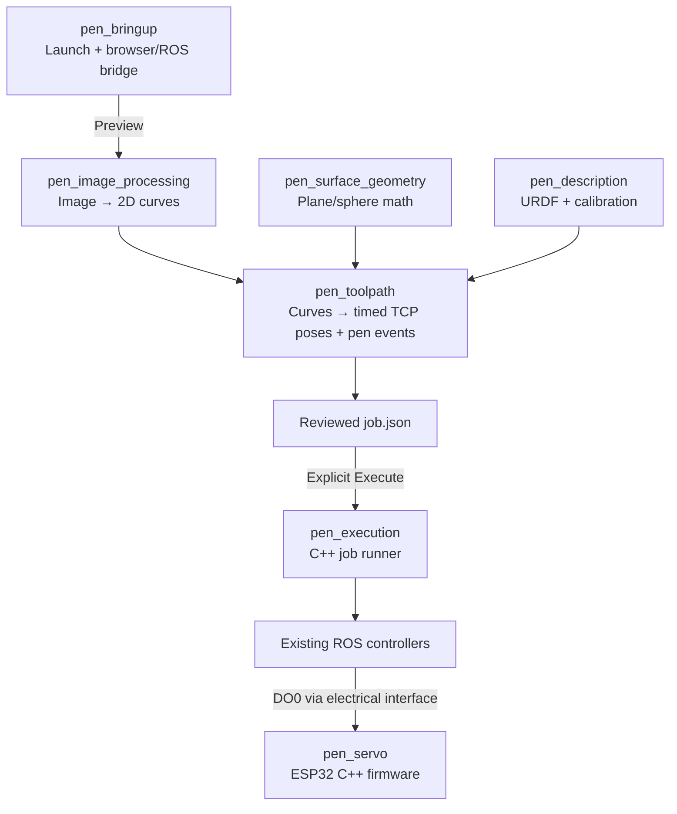
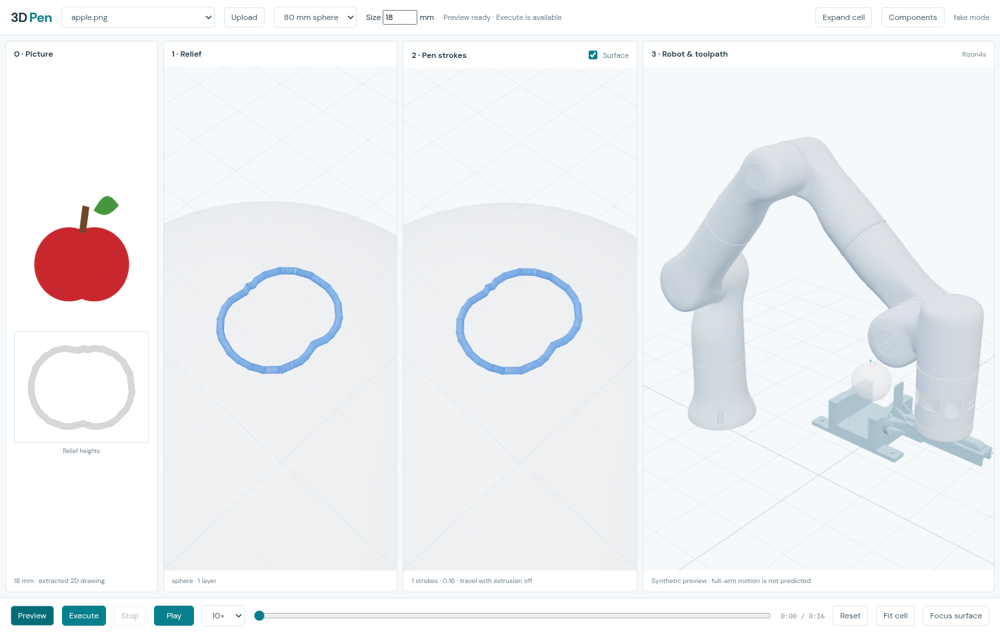
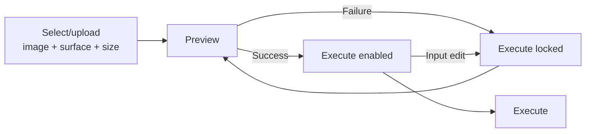
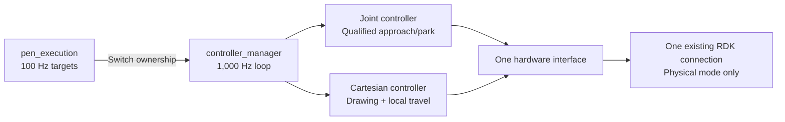
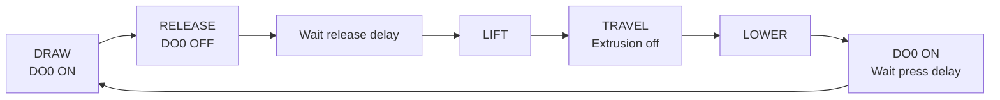

# Implementation

**2026-10-24 · Installed · Browser → ROS → fake hardware passed · Physical operation pending**

## Package map



**`pen_interfaces`** defines preparation, path-generation and execution actions.

Image/path nodes launch scientific Python workers. Geometry is a library; description is data; firmware runs on ESP32.

## Browser behavior





**Play animates the arm:** saved pose → approach → draw/lift → retract → return. Offline IK uses the current URDF and CAD tip; `robot_preview.json` stores the joint frames. **Execute commands ROS.** Server validates and consumes the preview token; changed input/profile/job hashes block execution.

## Motion and extrusion



Fake mode uses mock hardware. Offline IK drives visualization; the existing robot controller handles physical Cartesian commands. No new SDK connection or MoveIt planner.



Extrusion follows **stroke phases**, never the sign of Z motion. DO0 ON → GPIO35 LOW → press; OFF → HIGH → release. GPIO18 drives servo PWM. Firmware adds debounce, inactive-before-arm and a press-timeout fault.

**Stop / heartbeat loss:** request pen off, stop targets, deactivate owned arm controllers. No automatic retreat/resume. GPIO requests do not confirm physical release.

## Files and design choices

```text
assets/
├── meshes/             Canonical CAD + hashes
├── inputs/             JPG/PNG sources
└── outputs/<job>/
    ├── drawing.json    Inspect extraction
    ├── toolpath.json   Inspect surface mapping
    ├── job.json        Timed poses + extrusion events
    ├── robot_preview.json  Simulated arm approach/draw/return
    ├── report.json     Inspect validation
    └── execution.json  Final result
```

- Algorithms extracted; legacy `3d-pen` retains history and compatibility imports behind `COLCON_IGNORE`.
- `.venv-pen` isolates scientific dependencies from ROS Python.
- Preview/execution share one artifact; measurements stay null/TBD.
- [architecture.md](architecture.md) replaces both proposal files.

## Current state

| Verified | Remaining |
| --- | --- |
| Eight packages built; 95 tests passed | Physical fit, camera calibration and fixture verification |
| Browser preview, invalidation, fake execution, Stop | Automatic live tool/TCP/payload and loaded-description verification |
| Plane/sphere paths; release before lift | Qualified routes, fixture/arm clearance and real-time timing |
| ESP-IDF firmware compiled; host behavior tested | Flow timing, PWM enablement and physical tests |

**ESP32 bench firmware enabled (10 ms debounce, 2 s press limit). DO0 press/release, timeout release and rearm passed via serial logs. Arm remained stopped; physical horn motion awaits user confirmation.** Surface/tool-envelope checks do not establish full-arm collision clearance. Keep `commissioning_verified=false`.

Evidence: [`validation/pen/result.json`](../../robotics_setup/validation/pen/result.json). Known upstream issue: `joint_state_publisher` can report a shutdown-only ROS-context error.

```bash
cd ~/robotics_ws
./scripts/start-pen.sh fake
```

Open **http://127.0.0.1:8080**. [SSH/startup instructions](../README.md) · [Measurement template](../src/pen_description/config/calibration.template.yaml)

### Tool and surface registration

- Desired TCP matches the combined CAD tip: flange **[1.993, −2.292, 224.699] mm**, orientation parallel to flange axes. Original measurement components are retained in the profile.
- Flat drawing face follows the jig: base **[508, 0, 59.67] mm**, Z rotation **180°**. Its four tab holes use the existing CAD fit.
- `calibration.mocha.yaml` now contains the active `pen` tool readback: exact RDK TCP, 342 g mass, center of mass and inertia. CAD tip geometry is retained separately. Physical fit and commissioning remain unverified.

- Provisional extrusion start delay: **1.0 s after press**, used in measured and fake profiles. Release delay remains unmeasured. Regenerate previews/jobs to apply it.
