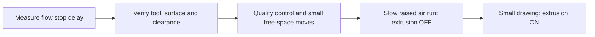

# Pen: bench test → air run → real drawing

**Current status:** servo tested; physical drawing is not commissioned. These are operator steps, not evidence that motion is safe. No robot motion was started when writing this guide.



## 1. Finish the bench checks

- Release → material stops was observed at approximately **0.15 s**. Each lifted stroke now starts with a **0.8 s extrusion-on hold after lowering** and ends with a **0.5 s total extrusion-on hold, then extrusion off and immediate lift**, configured by `pen.press_delay_s`, `pen.end_extrusion_dwell_s`, and `pen.release_delay_s: 0.0` in `src/pen_description/config/calibration.mocha.yaml`. Continuous strokes still pause in place with extrusion off for 2 seconds every 15 seconds and retain their separate 0.5-second restart lead (`pen.recycle_press_delay_s`); those pauses do not lift the tool. Keep the arm stopped for remaining bench checks.
- The operator-selected extrusion start delay is **0.8 s** after lowering for a new stroke. Continuous stroke timing now uses a short acceleration phase followed by constant cruise speed. Current firmware is **140° press / 110° release**, 50 Hz, 500–2400 µs; flash and ready/released boot are verified in `~/robotics_setup/validation/pen-hardware/press140-result.json`.
- The operator selected **600 seconds (10 minutes) total press**, including the start delay. The profile and flashed firmware match (`pen.max_press_s: 600.0`, `CONFIG_PEN_MAX_PRESS_MS=600000`). Flash hashes and ready/released startup were verified; the full-duration cutoff test remains pending. Evidence: `~/robotics_setup/validation/pen-hardware/press600-result.json`. The profile limit must not exceed the flashed firmware limit.
- Check release with the mechanism attached, startup with DO0 OFF, and loss of the input connection. A disconnected input must not float into a press request.

## 2. Complete physical commissioning

Profile: `src/pen_description/config/calibration.mocha.yaml`.

Current venue settings are **12 mm/s drawing speed**, **30 mm/s non-extruding travel**, and **1.3 mm pen-tip
stand-off**, measured along the fitted plane's outward normal. The plane is
registered from the four user-taught groove bottoms; its center is approximately
base `[509.346, -2.341, 60.953]` mm. The surface transform itself is not shifted
to implement stand-off. TCP compensation follows the tip offset. Requests below
1.3 mm stand-off are rejected. Regenerate jobs after changing settings.

| Already recorded | Still to verify/complete |
| --- | --- |
| Active tool `pen`; TCP, mass, COM, inertia read back | Confirm unchanged at each real startup |
| Flat top at base `[508, 0, 59.67]` mm | Check against the actual jig/plate |
| CAD pen-tip registration | Physical tip, holder clocking, cable clearance |
| Press delay 1.0 s; pre-lift release dwell 1.5 s; flashed press cap 600 s | Full-duration press-cap bench test |
| Servo bench behavior | Tool envelope, qualified joint approach/park routes |

Qualified routes contain seven-joint `start_positions`, then `points` with seven `positions` and increasing `time_s`, plus `qualified: true`. The executor checks the start against actual joints. **Do not paste the browser's simulated joint path as a qualified route.**

Qualify Cartesian hold, target timeout, Stop, joint/Cartesian switching and the complete real-time loop/network. See [robot startup](robot_startup.md). GPIO writes currently call a blocking SDK operation; their effect on loop timing must be included in qualification.

The recorded tool readback was a one-time check. Automatic runtime verification through the existing hardware owner is still pending. Never open another RDK connection while the real ROS driver owns the robot.

Only after obtaining the evidence: set `calibrated: true`, `qualified.cartesian/rt: true`, the applicable `qualification` flags, and route qualification. These flags record completed checks; they do not perform them. The current code requires pen qualification even for an air-run job.

## 3. Prepare terminals

### Latest evidence (2026-10-24)

The operator confirmed drawing directly on the flat plate, with no paper/tape
offset. The registered combined pen/holder CAD is enclosed by the profile's
75.926 mm radius, 302.635 mm length capsule. Recorded center approach and park
joint routes were replayed successfully and are now stored as qualified routes
in the profile. They connect the recorded park pose to a center hover 15.4 mm
above the plate; they do not automatically match an arbitrary job's first pose.

A 20 mm apple outline was traced with extrusion OFF at 10.4 mm drawing stand-off.
The combined joint approach/air trace/joint return passed, with 0.606 mm maximum
Cartesian tracking error and no rejected targets. The loop's reported maximum
period was 1.017 ms, with no periods above 1.5 ms. Network RTT was
0.690/0.892/1.076 ms minimum/average/maximum with no lost packets. These are
short-run observations, not full RT qualification. Extrusion-on GPIO transitions
and the real application's Stop/lifecycle remain untested. Overall calibration
and qualification flags remain false.

Evidence: `~/robotics_setup/validation/pen-hardware/apple-commissioning-summary.json`
and the artifacts it lists. Do not infer that the real drawing executor is ready
from the successful standalone qualification utility.

In **every real-run terminal**:

```bash
source ~/robotics_setup/env.sh
source ~/robotics_ws/install/setup.bash
export ROS_DOMAIN_ID=0
cd ~/robotics_ws
```

Keep fake simulation in domain **73**. Use port **8081** below to avoid the existing fake browser on 8080.

Before starting a real driver:

```bash
ulimit -r                      # expect at least 50
pgrep -af '[/]opt/ros/humble/lib/controller_manager/ros2_control_node'
```

Identify any existing driver by its launch/configuration. Reuse the intended real driver or stop it from its own terminal; never start two owners of the physical robot. The existing domain-73 fake driver is separate.

## 4. Initial control checks, before any drawing job

A commissioning operator must establish free space around the current pose and have the physical stop accessible. The real driver can enable the arm and clear faults during startup.

Every real hardware startup also runs `ZeroFTSensor` before starting controllers. The arm and mounted tool must be stationary and free of external contact, including contact with the plate. The existing hardware owner performs zeroing in primitive mode, then returns to stopped `IDLE`. Controller switching does not repeat zeroing. Startup fails on zeroing failure, lost readiness, or expiry of its 10-second completion deadline. SDK calls are blocking, so this is not a hard overall startup timeout.

On 2026-10-24, live startup zeroing, a three-second current-pose Cartesian hold, and target-withdrawal timeout passed. Timeout returned the robot to `IDLE` with both motion controllers inactive. Evidence: `~/robotics_setup/validation/pen-hardware/hold-timeout-result.json` and `commissioning-driver.log` in the same directory.

Explicit controller deactivation while holding and restoration of joint control subsequently passed (`stop-execute-result.json`). A +/-5 mm Z test at five seconds per leg completed and restored joint control: maximum observed tracking error 0.373 mm, final position error 0.110 mm. The Z run counted 17 rejected targets, with no timeout or reported cycle over 1.5 ms; the rejection cause remains unresolved (`z-execute-result.json`). These short tests do not qualify the application's Stop service, drawing motion, sustained real-time timing, or the remaining commissioning checks. No qualification flags were changed. Subsequent +/-5 mm X and Y checks at five seconds per leg also completed and restored joint control. Maximum tracking errors were 0.412 mm (X) and 0.252 mm (Y), with final position errors 0.192 mm and 0.106 mm. The rejected-target counter remained at 17 throughout both checks. Evidence: `x-execute-result.json` and `y-execute-result.json` in the same directory.

A subsequent center-approach test reached approximately 15.4 mm above the plate center and returned along the same path with extrusion off; maximum measured tracking error was 0.732 mm. Evidence: `~/robotics_setup/validation/pen-hardware/center-route-result.json`. The measured joint routes were initially retained as candidates without replay. The later combined apple qualification run replayed them successfully; see the latest evidence above.

For initial controller commissioning, the base robot driver is:

```bash
ros2 launch flexiv_cartesian_controller bringup.launch.py \
  robot_sn:=Rizon4s-063112 use_fake_hardware:=false start_rviz:=false
```

In another terminal, inspect controllers:

```bash
ros2 control list_controllers
```

Expect `rizon_arm_controller` active and `flexiv_cartesian_controller` inactive. Establish current-pose hold and Stop/timeout behavior under the [controller procedure](robot_startup.md) before progressing.

Preview a **5 mm free-space Z test**, with 5 seconds per leg:

```bash
ros2 run flexiv_cartesian_controller cartesian_offset_test \
  --axis z --distance 0.005 --seconds-per-leg 5
```

After reviewing both positive and negative Z clearance, execute that exact test:

```bash
ros2 run flexiv_cartesian_controller cartesian_offset_test \
  --axis z --distance 0.005 --seconds-per-leg 5 --execute
```

This moves up **and down** around the starting pose; it is not a drawing air run. Do not start near the plate. Verify motion, switching back to joint control and stopping before moving on. Stop this driver from its launch terminal before replacing it with the full cell below.

## 5. Start the commissioned full cell

**The following commands are for after section 2 is complete. They currently fail closed on the incomplete profile.**

Terminal 1: render the calibrated cell, then start its real driver:

```bash
ros2 run pen_description render_description \
  --profile "$PWD/src/pen_description/config/calibration.mocha.yaml" \
  --mode real --robot-sn Rizon4s-063112 --ros2-control \
  > /tmp/pen-real-cell.urdf && \
ros2 launch flexiv_cartesian_controller bringup.launch.py \
  robot_sn:=Rizon4s-063112 use_fake_hardware:=false \
  description_file:=/tmp/pen-real-cell.urdf start_rviz:=false
```

Terminal 2: the real bringup normally spawns GPIO. Check first; run the spawner below only if the controller is absent (inspect errors if it exists but is inactive):

```bash
ros2 control list_controllers
cat > /tmp/pen-real-gpio.yaml <<'YAML'
/**/gpio_controller:
  ros__parameters:
    robot_sn: Rizon4s-063112
YAML
ros2 run controller_manager spawner gpio_controller \
  --controller-manager /controller_manager -p /tmp/pen-real-gpio.yaml
```

With GPIO active, request release before continuing:

```bash
ros2 topic pub --once /Rizon4s_063112/gpio_outputs flexiv_msgs/msg/GPIOStates \
  '{states: [{pin: 0, state: false}]}'
```

Terminal 3: start the application **only after commissioning is verified**:

```bash
ros2 launch pen_bringup app.launch.py \
  execution_mode:=real robot_sn:=Rizon4s-063112 \
  profile:="$PWD/src/pen_description/config/calibration.mocha.yaml" \
  workspace:="$PWD" port:=8081 commissioning_verified:=true
```

The executor expects joint control active, Cartesian inactive and GPIO active. It handles switching itself.

## 6. Generate and review a slow air-run job

The current browser has no air-offset control. Compile a **separate** raised job; setting the action's `air_run` flag alone does not raise a normal job.

Choose a small image already in `assets/inputs`, then run:

```bash
export PEN_IMAGE="$PWD/assets/inputs/REPLACE_WITH_YOUR_IMAGE.png"
python3 - <<'PY'
import json, os
from pathlib import Path
root = Path.cwd()
request = {
    'image_path': os.environ['PEN_IMAGE'], 'size_mm': 5,
    'surface': 'plane', 'execution_mode': 'real',
    'profile_path': str(root/'src/pen_description/config/calibration.mocha.yaml'),
    'speed_m_s': 0.002, 'air_offset_m': 0.010,
}
Path('/tmp/pen-air-request.json').write_text(json.dumps(request))
PY
env -u PYTHONPATH .venv-pen/bin/python -m pen_toolpath.worker \
  --request /tmp/pen-air-request.json --out "$PWD/assets/outputs/commissioning-air"
```

This requests **2 mm/s** and adds **10 mm** to the normal 1.3 mm stand-off, for **11.3 mm** tip clearance during the air drawing. Inspect the generated `toolpath.json`, `job.json`, and `report.json`; confirm the actual path, joint routes, bounds and all extrusion flags before executing. CLI generation does not provide browser animation or collision qualification.

Terminal 4: after that review, execute with a heartbeat tied to this terminal:

```bash
python3 - <<'PY'
import hashlib, json
from pathlib import Path
p = (Path.cwd()/'assets/outputs/commissioning-air/job.json').resolve()
b = p.read_bytes(); job = json.loads(b)
assert job['air_run'] is True
assert all(not sample['extrude'] for sample in job['samples'])
Path('/tmp/pen-air-goal.json').write_text(json.dumps({
    'job_path': str(p), 'expected_sha256': hashlib.sha256(b).hexdigest(), 'air_run': True,
}))
PY
(
  ros2 topic pub -r 5 /pen/heartbeat std_msgs/msg/Empty '{}' >/tmp/pen-heartbeat.log 2>&1 &
  pen_heartbeat_pid=$!
  cleanup_pen_run() {
    ros2 service call /pen/stop std_srvs/srv/Trigger '{}' >/dev/null 2>&1
    kill "$pen_heartbeat_pid" 2>/dev/null || true
  }
  trap cleanup_pen_run EXIT
  trap 'exit 130' INT TERM
  ros2 action send_goal /pen/execute pen_interfaces/action/ExecuteDrawing \
    "$(cat /tmp/pen-air-goal.json)" --feedback
)
```

Do not run browser Execute at the same time. The air run must keep DO0 OFF throughout. Watch the entire arm, fixture, camera and cables—not just the tip. Success means correct approach, raised drawing path, lift/travel and joint return, with adequate clearance and no tracking/timeout errors.

## 7. First actual drawing

After a successful air run, use the real browser at **http://127.0.0.1:8081**.
The current selection prepares automatically; **Play** animates it and **Execute**
requests physical execution. The venue profile uses **12 mm/s while drawing**,
**30 mm/s for non-extruding Cartesian travel**, and **1.3 mm stand-off**. The
picture panel shows the compiled settings. Playback speed does not change robot
speed. The saved joint approach/park routes retain their independently checked
schedule.

Normal execution: **joint approach → Cartesian draw/lift/travel → joint park**. Each continuous extrusion segment, including its start dwell, must fit the configured press limit. Changing the profile or image requires a new job/preview.

## Stop / abort

Browser **Stop**, or from a prepared terminal:

```bash
ros2 service call /pen/stop std_srvs/srv/Trigger '{}'
```

Use the physical stop if motion is unsafe. Separately powered servo/pen electronics may remain energized. After an abort, inspect actual pose and controller states; there is no automatic return. Stop the driver with Ctrl+C in Terminal 1. Do not blindly reactivate controllers or retry from an unknown pose.
